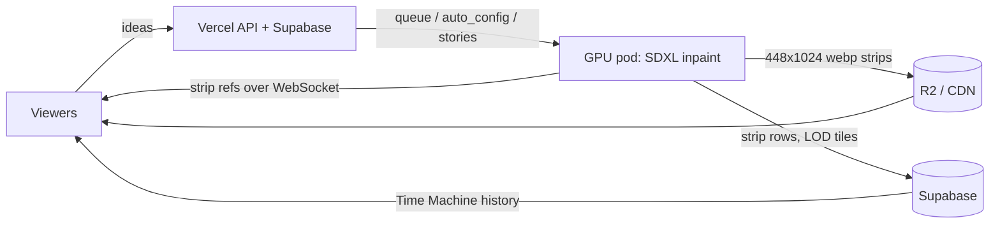

# Infinite Tapestry

**An endless painting, streamed live. You choose where it goes.**


*Unedited live output from Oct 14, 2026, around 1:55 AM CT: about 50 strips with every seam exactly as viewers saw it.*

A GPU worker paints the canvas one 256 px strip at a time. It never stops, never rewinds, and never repeats. Each new strip is outpainted from the pixels to its left, so the picture is one continuous scroll. When the subject changes, a fresh scene is painted and blended in. Anyone watching can type an idea, and a few seconds later the tapestry turns toward it. When nobody steers, **Auto** (the built-in director) picks the next scene or tells a multi-scene story.

**Live at [infinitetapestry.app](https://infinitetapestry.app)** · [How it works, in depth → docs/METHOD.md](docs/METHOD.md)


## How it works in 30 seconds



1. **Outpaint.** The model is SDXL inpainting (RealVisXL V4). It sees a 1024×1024 window: 768 px of what's already on screen plus a masked 256 px slot to fill. It has 18 steps at CFG 6.
2. **Fuse.** The masked slot starts as *mean colour + noise*, not stretched edge pixels, so nothing seeds horizontal bands. Each strip carries a 192 px overlap that is cross-faded into the canvas.
3. **Change scenes cleanly.** A new subject is painted *fresh* (txt2img) and stitched on with a 192 px crossfade plus a 0.85-strength "bridge" repaint, so the old layout never bleeds into the new one.
4. **Direct.** Ideas from viewers take over in a strip or two. Otherwise Auto picks scenes from a rotating pool of eras, places, subjects and looks, or plays a story with one consistent look.
5. **Remember.** Every strip is stored forever by index. The [Time Machine](https://infinitetapestry.app/time-machine) maps any hour of any day back to its strips.

| Before (row-mean prefill) | After (mean + noise, fresh anchors) |
|---|---|
|  |  |

*The same prompt sequence before and after v1.0. The old prefill copied each row's edge colour across the hole, which grew into stripes, banners and rows of people.*

## Repo map

| Path | What |
|---|---|
| `infinite_tapestry/` | GPU worker: generator, inpaint backends, director (`prompts.py`), Auto (`autopilot.py`, `interpreter.py`, `variety.py`), storage (`store.py`, `lod.py`), WebSocket server |
| `web/api/`, `web/lib/` | Vercel functions: live config, history and tiles (`about.js`), ideas, admin, Talk to Auto (`autochat.js`), share pages |
| `static/` | The site: live viewer (`client.js`), landing, Time Machine, Fuel, profile |
| `web/admin_src/` | Admin UI source, packed by `scripts/gen_admin_ui.py` |
| `supabase/migrations/` | Database schema |
| `scripts/pod/` | Pod boot, release fetch, supervisor |
| `tests/` | `pytest` suite (runs on CPU with the mock backend) |

## Run it locally (no GPU)

```bash
python3 -m venv .venv && source .venv/bin/activate
pip install -e . && pip install pytest httpx
python -m infinite_tapestry.main --mock --port 8000   # http://127.0.0.1:8000 — a fake tapestry
pytest -q
```

On a 24 GB GPU, `python -m infinite_tapestry.main --backend sdxl` applies the SDXL preset (1024 px window, 256 px strips, fresh anchors). The production deploy is in [docs/PRODUCTION.md](docs/PRODUCTION.md).

## Admin live settings

Scene widths (Auto and ideas, as min–max strip ranges), the join crossfade width and the bridge repaint strength are set with sliders in the admin's **Live render** view. A schematic ribbon previews them. Values are saved to `auto_config.render`, and the pod re-reads them every 15 s, so no restart is needed.

---

Deeper dive: **[docs/METHOD.md](docs/METHOD.md)** covers fusion, the model, Auto and stories, storage and streaming, and how the Time Machine finds a moment. [docs/research.md](docs/research.md) holds the original feasibility notes (SD1.5 era, kept for history).
