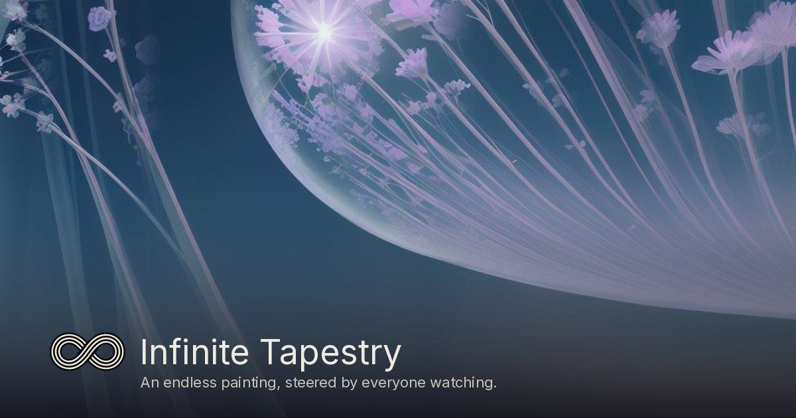
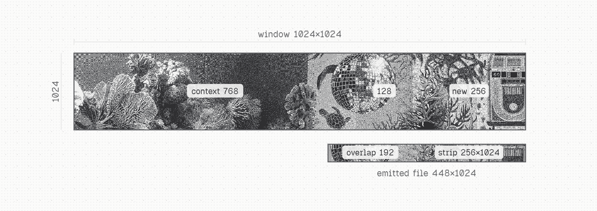
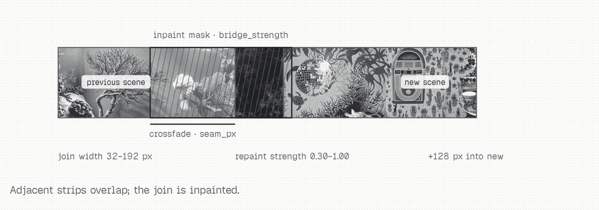
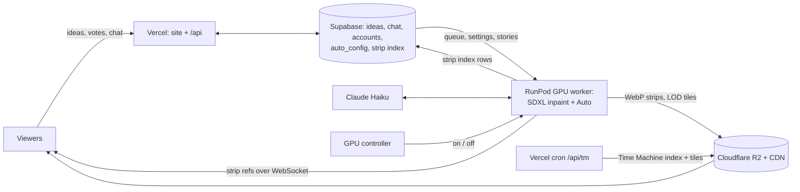

# Infinite Tapestry

**One endless painting, painted live. Anyone watching can steer it.**

[](https://github.com/bicrick/infinite-tapestry/actions/workflows/ci.yml)
[](LICENSE)
[](https://infinitetapestry.app)

[Live site](https://infinitetapestry.app) · [Project write-up](https://www.bicrick.com/projects/infinite-tapestry) · [Method in depth](docs/METHOD.md)



## What it is

Infinite Tapestry is an endless, infinitely extending painting. A GPU paints it one strip at a time, live, while people
watch it scroll by. It never rewinds and never repeats: strip *n* is the *n*-th thing ever painted, so every moment has
a permanent address.

Anyone can prompt the tapestry, and their idea is woven in. Each prompt is painted word for word as its own scene and
joined to the scroll for everyone watching. When nobody is steering, **Auto**, a director built on Claude Haiku, picks
the next scene: it switches themes, styles and stories on its own, so the scroll keeps moving.


*An unedited stretch of live output, every seam exactly as viewers saw it.*

## How it works

### Painting a strip

Inpainting happens off screen. Each new strip is painted and joined before it scrolls into view, so the tapestry on
screen is already one piece.

The model sees a **1024×1024 window**: the last 768 px already on the canvas, plus a masked 256 px slot to fill. The
mask also reaches 128 px back into the context, so the model redraws the edge it continues from and the joint is drawn
in one pass. The masked area starts as the context's mean colour plus noise, which gives the model nothing to streak.
After generation, colour drift is corrected against the kept context and low-frequency colour steps at the mask edge
are smoothed away (`canvas.py`). Each emitted strip is **448×1024**: 192 px of overlap plus 256 px of new pixels.
The overlap is crossfaded on the server, and the browser feathers it again, so viewers never see a hard edge.



The model is **RealVisXL V5.0** (a fine-tuned SDXL) merged into the SDXL inpainting UNet on the GPU box
(`sdxl_merge.py`), run in fp16 with DPM++ 2M Karras. The defaults are 20 steps at CFG 6.5, with guidance applied for
the first half of the steps, which comes to about 2 s per strip on an RTX 4090. Steps, CFG and the guidance cut are
live settings.

### Joining scenes

A prompt arrives as its own picture. A new scene is painted fresh, with none of the old pixels, and then laid next to
the tail of the tapestry. A crossfade (`seam_px`, up to 192 px) settles the colours, and a masked **bridge repaint**
(`bridge_strength`, 0.85 by default) redraws the join, reaching 128 px into the new scene, so objects connect instead
of ghosting. Everything outside the mask is kept exactly. The model is convinced it already drew both halves and fills
the gap between.



Scene lengths are drawn at random per scene: 3–9 strips for Auto, 5–7 for viewer ideas. Join width, repaint strength,
scene widths, steps and CFG are all set from the admin **Configuration** tab (`auto_config.render`), and the pod
applies them within 30 s without a restart.

### Directing: viewers first, then Auto

- **Viewer prompts take priority.** Ideas queue fairly and are painted in turn, ahead of anything Auto was about to
  invent. The text is kept verbatim; Haiku only adds a title. A viewer idea takes over within a strip or two, with a
  CFG boost. Image ideas steer the scene through IP-Adapter.
- **Auto fills the gaps.** When the queue runs low, Auto (Claude Haiku 5.5) plans the next scenes. Each request
  carries the recent scenes, the time of day and a random *spark* (an era, a place, a subject and a look), so it keeps
  finding new territory. A pick can be a short journey with one premise and one look.
- **Stories.** Multi-scene stories with one consistent style are written in admin or drafted with *Talk to Auto*, and
  play without an LLM call per scene.
- **Safety** is enforced on the input: keyword and allowlist screens, optional OpenAI moderation, rate limits and an
  NSFW classifier for uploaded images. See [docs/SAFETY.md](docs/SAFETY.md).

### Storing and streaming

Every strip is stored forever. The pod writes it to **Cloudflare R2** as WebP (`live-sdxl/strips/{index}.webp`, served
through the CDN) and writes an index row to **Supabase**. It then broadcasts a small reference over a WebSocket. The
browser fetches the image from the CDN, feathers the overlap and scrolls. In auto mode, scroll speed follows the GPU's
actual throughput (60 px/s nominal for SDXL), staying a little under it so the buffer never runs dry.

- **Replay mode.** When the GPU is offline, the site keeps playing: each page load starts at a random point in the
  stored history, and the prompt box becomes a quiet *GPU is offline · You're watching a replay* status.
- **Time Machine.** [/time-machine](https://infinitetapestry.app/time-machine) maps any hour of any day to its strips
  and opens the viewer right there. A Vercel cron (`/api/tm`, every 5 minutes) folds new strips into the time index and
  extends a zoomable tile pyramid on R2.
- **Accounts, ideas, votes and chat** live in Supabase Postgres, with row-level security on every table and server-side
  functions for writes.

## Architecture



| Piece | Runs on | Role |
|---|---|---|
| GPU worker (`infinite_tapestry/`) | RunPod (24 GB GPU, RTX 4090 preferred) | paints, joins and stores strips; runs Auto; WebSocket server |
| Site and API (`frontend/`, `web/`) | Vercel | viewer, Time Machine, ideas, chat, admin, GPU switch, cron jobs |
| Database (`supabase/migrations/`) | Supabase Postgres + Auth | ideas queue, chat, accounts, settings, strip index |
| Images | Cloudflare R2 + CDN | every strip and tile, served publicly |

## Repo layout

| Path | What |
|---|---|
| `infinite_tapestry/` | GPU worker: generator, SDXL inpaint backend (SD 1.5 optional), director (`prompts.py`), Auto (`autopilot.py`, `interpreter.py`, `variety.py`), storage (`store.py`, `lod.py`), WebSocket server (`server.py`) |
| `web/api/`, `web/lib/` | Vercel functions: live config, history and tiles (`about.js`, `tm.js`), ideas, chat, admin, GPU switch, Talk to Auto, share pages |
| `frontend/` | The site (Vite + TypeScript): pages (`*.html`), live viewer (`src/viewer/`: camera, renderer, motion, stream), shared code (`src/core/`), page entries (`src/entries/`), not-yet-ported page scripts (`src/legacy/`), CSS (`src/styles/`), static files (`public/`) |
| `web/admin_src/` | Admin UI source, packed by `scripts/gen_admin_ui.py` |
| `supabase/migrations/` | Database schema |
| `scripts/pod/` | Pod boot, release fetch, supervisor |
| `scripts/ci/` | Secrets manifest and sync |
| `scripts/ops/` | Operator tools (pod health, pod SSH) |
| `scripts/dev/` | Developer tools (load-in frame-timing capture) |
| `tests/` | `pytest` suite (CPU, mock backend, no network) |

## Running locally

```bash
git clone https://github.com/bicrick/infinite-tapestry && cd infinite-tapestry
make setup    # .venv + package + test deps (Python 3.10+) + npm ci (Node 20+)
make test     # pytest + typecheck + Vitest + JS syntax check; no secrets, no network
make dev      # builds the site (npm run build), then CPU mock worker + viewer at http://127.0.0.1:8000 (PORT=... to change)
make dev-ui   # Vite dev server with hot reload (proxies /ws, /timeline, /lod to the worker on :8000)
```

The site builds with `npm ci && npm run build` into `dist/site` (what the worker serves locally);
`scripts/build_web.sh OUT` assembles the full Vercel bundle (site + `web/api` + config).

`cp .env.example .env` to enable optional pieces such as the Auto director (Anthropic key). On a 24 GB GPU,
`pip install -e ".[gpu]"` and `make dev-gpu` run the real SDXL worker. `make help` lists every target.

## Deploying

Production deploys only through GitHub Actions (`.github/workflows/ci.yml`). Every push to `main` runs the tests,
publishes a new worker release when the worker code changed, syncs runtime secrets from GitHub to Vercel, and deploys
the site to Vercel with a smoke test before the domains move. The GPU pod picks up new worker releases on its own.
`make deploy` runs the tests, pushes and follows the CI run. Secrets, scheduled jobs and setting up a new environment
are covered in [docs/OPERATIONS.md](docs/OPERATIONS.md).

## License and models

The code in this repo is MIT licensed (see [LICENSE](LICENSE)).

No model weights are stored here. The GPU worker downloads public weights from Hugging Face at runtime, and the
RealVisXL V5.0 inpainting UNet is merged on the pod (`infinite_tapestry/sdxl_merge.py`) and cached there, never
committed or redistributed. Those weights keep their own licenses, including the use-based restrictions in the
OpenRAIL licenses, which apply to anyone who runs this code:

| Model | Used for | License |
| --- | --- | --- |
| [stabilityai/stable-diffusion-xl-base-1.0](https://huggingface.co/stabilityai/stable-diffusion-xl-base-1.0) | merge base | CreativeML Open RAIL++-M |
| [diffusers/stable-diffusion-xl-1.0-inpainting-0.1](https://huggingface.co/diffusers/stable-diffusion-xl-1.0-inpainting-0.1) | merge inpaint UNet | CreativeML Open RAIL++-M |
| [SG161222/RealVisXL_V5.0](https://huggingface.co/SG161222/RealVisXL_V5.0) | merge tuned weights, text encoders, VAE | CreativeML Open RAIL++-M |
| [OzzyGT/RealVisXL_V4.0_inpainting](https://huggingface.co/OzzyGT/RealVisXL_V4.0_inpainting) | fallback model | CreativeML Open RAIL++-M |
| [madebyollin/sdxl-vae-fp16-fix](https://huggingface.co/madebyollin/sdxl-vae-fp16-fix) | fp16-safe VAE | MIT |
| [Lykon/dreamshaper-8-inpainting](https://huggingface.co/Lykon/dreamshaper-8-inpainting) | SD 1.5 backend (optional) | CreativeML OpenRAIL-M |
| [nerijs/pixel-art-xl](https://huggingface.co/nerijs/pixel-art-xl) | style LoRA | CreativeML OpenRAIL-M |
| [ostris/watercolor_style_lora_sdxl](https://huggingface.co/ostris/watercolor_style_lora_sdxl) | style LoRA | Apache-2.0 |
| [TheLastBen/Papercut_SDXL](https://huggingface.co/TheLastBen/Papercut_SDXL) | style LoRA | CreativeML OpenRAIL-M |

---

Contributing: [CONTRIBUTING.md](CONTRIBUTING.md) · Security: [SECURITY.md](SECURITY.md)

More: [docs/METHOD.md](docs/METHOD.md) (the method at three zoom levels) · [docs/SAFETY.md](docs/SAFETY.md) (how ideas
and images are screened) · [docs/OPERATIONS.md](docs/OPERATIONS.md) (running production).
