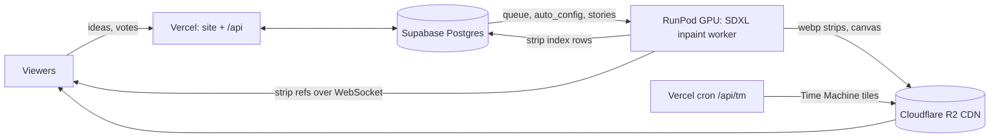

# Infinite Tapestry

**An endless painting, streamed live. You choose where it goes.**


*Unedited live output from Oct 14, 2026, around 1:55 AM CT: about 50 strips with every seam exactly as viewers saw it.*

A GPU worker paints the canvas one 256 px strip at a time. It never stops, never rewinds, and never repeats. Each new strip is outpainted from the pixels to its left, so the picture is one continuous scroll. When the subject changes, a fresh scene is painted and blended in. Anyone watching can type an idea, and a few seconds later the tapestry turns toward it. When nobody steers, **Auto** (the built-in director) picks the next scene or tells a multi-scene story.

**Live at [infinitetapestry.app](https://infinitetapestry.app)** · [How it works, in depth → docs/METHOD.md](docs/METHOD.md) · [Operations → docs/OPERATIONS.md](docs/OPERATIONS.md)


## How it works in 30 seconds



1. **Outpaint.** SDXL inpainting (a RealVisXL V5 merge, DPM++ 2M Karras, fp16) sees a 1024×1024 window: 768 px of
   what is already on screen plus a masked 256 px slot to fill. Steps and CFG are live settings (`auto_config.render`).
2. **Fuse.** The masked slot starts as *mean colour + noise*, not stretched edge pixels, so nothing seeds horizontal
   bands. Each strip carries a 192 px overlap that is cross-faded into the canvas.
3. **Change scenes cleanly.** A new subject is painted *fresh* and stitched on with a crossfade plus a "bridge"
   repaint, so the old layout never bleeds into the new one.
4. **Direct.** Ideas from viewers take over in a strip or two. Otherwise Auto picks scenes from a rotating pool of
   eras, places, subjects and looks, or plays a story with one consistent look.
5. **Remember.** Every strip is stored forever on R2 by index. The [Time Machine](https://infinitetapestry.app/time-machine)
   maps any hour of any day back to its strips.

| Before (row-mean prefill) | After (mean + noise, fresh anchors) |
|---|---|
|  |  |

*The same prompt sequence before and after v1.0. The old prefill copied each row's edge colour across the hole, which grew into stripes, banners and rows of people.*

## Repo map

| Path | What |
|---|---|
| `infinite_tapestry/` | GPU worker: generator, SDXL inpaint backend (SD1.5 fallback), director (`prompts.py`), Auto (`autopilot.py`, `interpreter.py`, `variety.py`), storage (`store.py` → R2 + Postgres, `lod.py`), WebSocket server |
| `web/api/`, `web/lib/` | Vercel functions: live config (`live.js`), history and tiles (`about.js`, `tm.js`), ideas, admin, GPU switch (`gpu.js`), Talk to Auto, share pages |
| `static/` | The site: live viewer (`client.js`), landing, Time Machine, Fuel, profile |
| `web/admin_src/` | Admin UI source, packed by `scripts/gen_admin_ui.py` |
| `supabase/migrations/` | Database schema |
| `scripts/pod/` | Pod boot, release fetch, supervisor (follows CI releases) |
| `scripts/ci/` | Secrets manifest + sync (GitHub secrets → Vercel, pod) |
| `scripts/ops/` | Ops tools that run anywhere (pod health, pod SSH, storage migration) |
| `tests/` | `pytest` suite (CPU, mock backend, no network) |

## Clone → configure → run → deploy

```bash
git clone https://github.com/bicrick/infinite-tapestry && cd infinite-tapestry
make setup            # .venv + package + test deps (Python 3.10+, Node 18+ for the JS checks)
make test             # no secrets, no network
make dev              # mock worker + viewer at http://127.0.0.1:8000 (PORT=… to change)
cp .env.example .env  # optional: real Auto director, ops helpers
make deploy           # tests, push main, follow CI: site to Vercel, worker release to the pod
```

On a 24 GB GPU, `pip install -e ".[gpu]"` and `make dev-gpu` run the real SDXL worker. Production deploys only
through CI; the pod picks up new worker releases by itself. Secrets, CI flow, rollback and rebuilding from scratch:
**[docs/OPERATIONS.md](docs/OPERATIONS.md)**.

## Admin live settings

Scene widths, the join crossfade width and the bridge repaint strength are set in the admin's **Configuration** tab.
Values are saved to `auto_config.render` (which also takes the sampler keys `steps` and `cfg`), and the pod re-reads
them every 15 s, so no restart is needed.

## License and models

The code in this repo is MIT licensed (see [LICENSE](LICENSE)).

No model weights are stored here. The GPU worker downloads public weights from Hugging Face at runtime, and the
RealVisXL V5.0 inpainting UNet is merged on the pod (`infinite_tapestry/sdxl_merge.py`) and cached there, never
committed or redistributed. Those weights keep their own licenses, including the use-based restrictions in the
OpenRAIL licenses, which apply to anyone who runs this code:

| Model | Used for | License |
| --- | --- | --- |
| [stabilityai/stable-diffusion-xl-base-1.0](https://huggingface.co/stabilityai/stable-diffusion-xl-base-1.0) | merge base | CreativeML Open RAIL++-M |
| [diffusers/stable-diffusion-xl-1.0-inpainting-0.1](https://huggingface.co/diffusers/stable-diffusion-xl-1.0-inpainting-0.1) | merge inpaint UNet | CreativeML Open RAIL++-M |
| [SG161222/RealVisXL_V5.0](https://huggingface.co/SG161222/RealVisXL_V5.0) | merge tuned weights, text encoders, VAE | CreativeML Open RAIL++-M |
| [OzzyGT/RealVisXL_V4.0_inpainting](https://huggingface.co/OzzyGT/RealVisXL_V4.0_inpainting) | previous default model | CreativeML Open RAIL++-M |
| [madebyollin/sdxl-vae-fp16-fix](https://huggingface.co/madebyollin/sdxl-vae-fp16-fix) | fp16-safe VAE | MIT |
| [Lykon/dreamshaper-8-inpainting](https://huggingface.co/Lykon/dreamshaper-8-inpainting) | SD 1.5 backend (optional) | CreativeML OpenRAIL-M |
| [nerijs/pixel-art-xl](https://huggingface.co/nerijs/pixel-art-xl) | style LoRA | CreativeML OpenRAIL-M |
| [ostris/watercolor_style_lora_sdxl](https://huggingface.co/ostris/watercolor_style_lora_sdxl) | style LoRA | Apache-2.0 |
| [TheLastBen/Papercut_SDXL](https://huggingface.co/TheLastBen/Papercut_SDXL) | style LoRA | CreativeML OpenRAIL-M |

---

Deeper dive: **[docs/METHOD.md](docs/METHOD.md)** covers fusion, the model, Auto and stories, storage and streaming, and
how the Time Machine finds a moment. [docs/SAFETY.md](docs/SAFETY.md) explains how ideas and uploaded images are screened.
