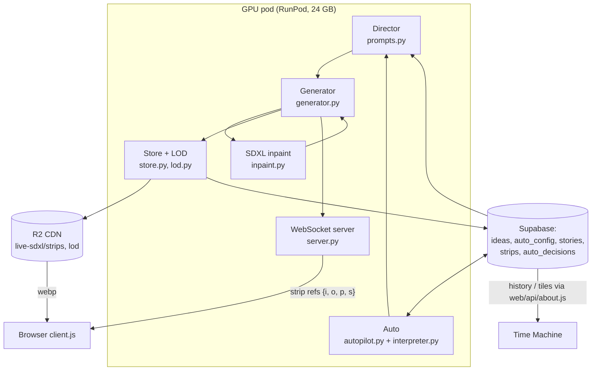
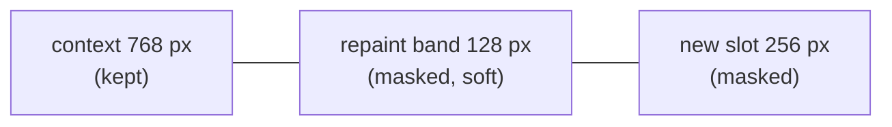
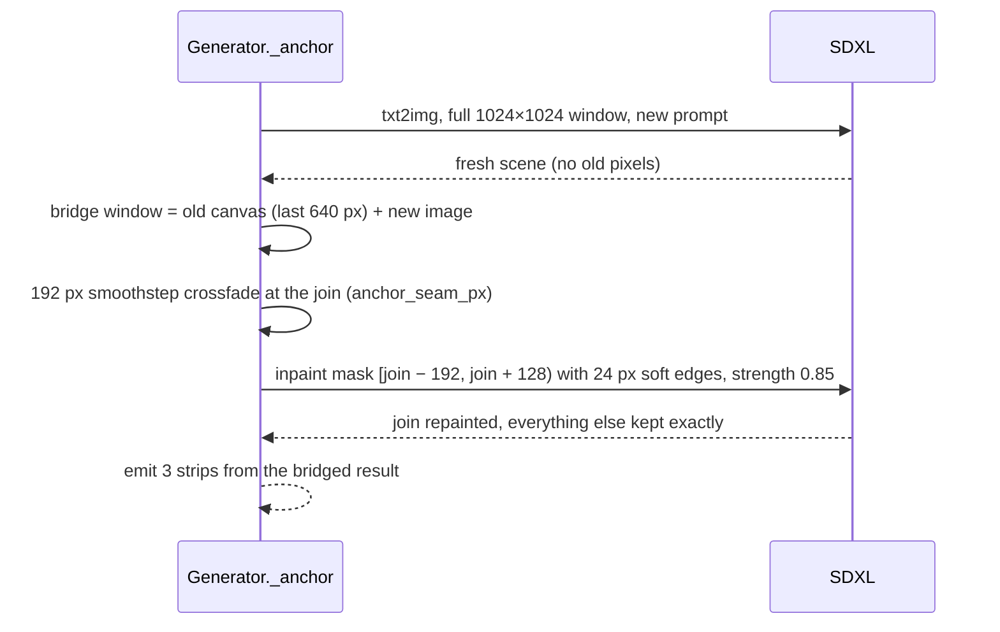
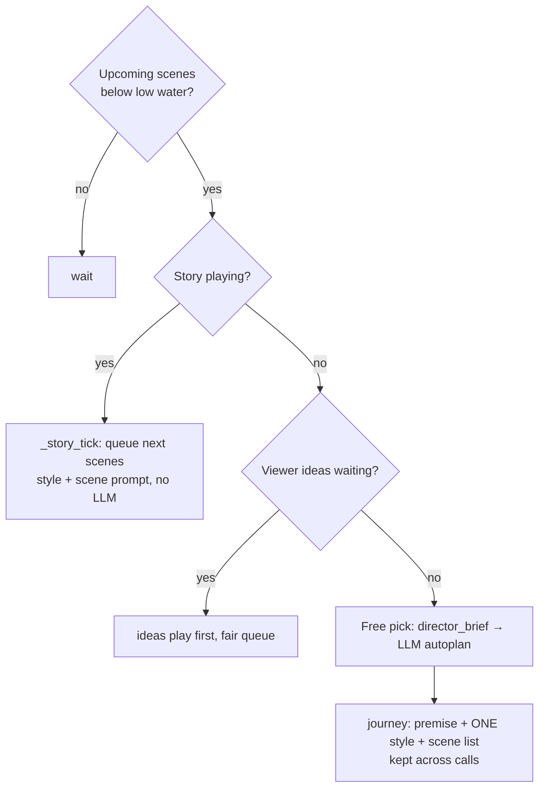
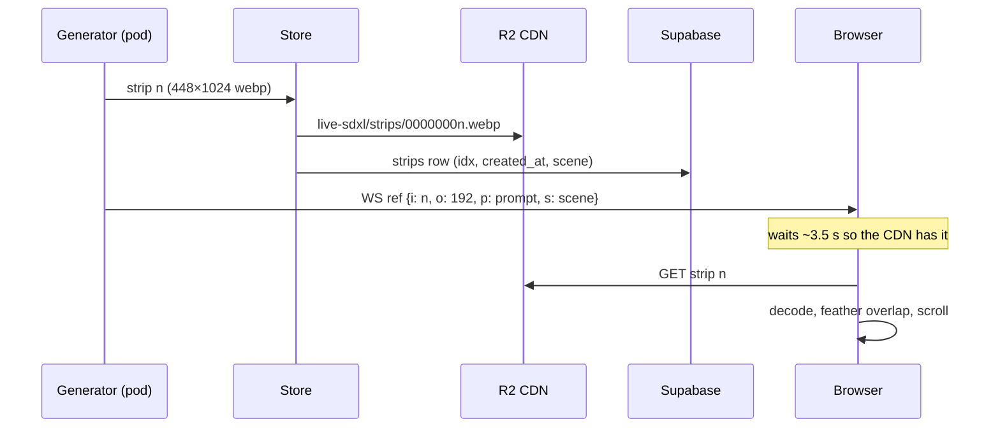
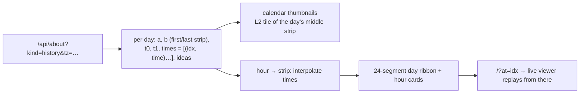

# How Infinite Tapestry paints forever

This document explains the method at three zoom levels. **High** is the shape of the system. **Mid** covers how pixels are fused and scenes are chosen. **Low** gives the exact numbers, file layouts and indices. Everything here matches the code in this repo (v1.1). File paths are given so you can check. How ideas and uploaded images are screened is in **[SAFETY.md](SAFETY.md)**.

---

## 1. High level

The tapestry is one infinitely wide image, 1024 px tall. It grows to the right in **strips** 256 px wide. Strip *n* is always the *n*-th thing ever painted. Nothing is regenerated or reordered, so a strip index is a permanent address for a moment.

There are three loops:

- **Paint loop (GPU, ~3.5 s per strip):** take the director's current prompt, outpaint the next strip, fuse it into the rolling canvas, store it, and announce it.
- **Direct loop (Auto):** every 15 s the pod re-reads `auto_config` (theme, pause, render settings). When the queue of upcoming scenes runs low, Auto plans more.
- **Watch loop (browser):** receive strip refs, fetch the images from the CDN, and scroll smoothly. Slow down if the buffer runs thin.

---

## 2. Mid level

### 2.1 Fusing images: outpaint, overlap, crossfade

Each step builds a **1024×1024 window**. The left 768 px are context: the last pixels already on the canvas. The right 256 px are the new slot.

The mask covers the new slot **plus a 128 px repaint band** reaching back into the context. The model is allowed to *re-draw* the edge it continues from, so the joint is drawn in one pass and not glued together. After generation:

1. `correct_drift` corrects the global colour drift of the generated window against the kept context. Diffusion slightly shifts the palette even on unmasked pixels.
2. `harmonize_seam` removes low-frequency colour **steps** at the mask edge, row by row and smoothed vertically, so texture survives (`canvas.py`).
3. `stitch_generated_window` pastes the window into the canvas. The last **192 px overlap** gets a smoothstep crossfade.

Each emitted strip file is **448×1024**: 192 px of overlap plus 256 px of new pixels. The browser feathers the overlap over the previous strip in the same way, so viewers never see a hard edge. (If you stitch strips yourself, blend the overlap too. Butting the right 256 px together produces fake vertical steps.)

### 2.2 Why "mean + noise" (the v1.0 banding fix)

Diffusion inpainting doesn't start from pure noise. It noises a **prefill** of the masked area. The old prefill copied each row's edge colour across the hole, which literally drew horizontal stripes. The model obligingly turned them into banners, strata, shelves and rows of people. Worse, a user-idea takeover repaints ~670 px from that striped start, so whole scenes came out "stuck in bands".

Since v1.0 (`prefill_mode = "meannoise"`, `inpaint.py`), the hole is filled with the **context's mean colour plus isotropic Gaussian noise (σ = 40)**. It has no row structure, so there is nothing to band. A fully masked window (a fresh anchor, below) gets mid-gray 128 + noise (σ = 50), not a flat card.

| Before | After |
|---|---|
|  |  |

### 2.3 Scene changes: the fresh anchor

Continuing a scene by outpainting is great. *Changing* scenes that way drags the old horizon and layout into the new subject. With `fresh_anchor` (SDXL preset), a new scene is painted on its own:

The crossfade gets the colours roughly right. The **bridge repaint** at strength 0.85 (`anchor_bridge_strength`) redraws the join zone so objects connect and don't ghost. Unmasked pixels are copied back exactly, so the new composition survives intact.

Both numbers are **live settings**. The admin **Configuration** tab has sliders for the join width (32–192 px) and the bridge strength (0.30–1.00). It saves them to `auto_config.render`, and the pod applies them within ~15 s (`server.apply_render_settings`).

### 2.4 Scene length: random widths

A scene lasts *width* strips: a blend-in transition plus a hold. Since v1.1 the width is **drawn at random per scene** (`LiveDirector._width`), so the ribbon has an organic rhythm and not a metronome:

- Auto scenes: 3–9 strips (default)
- Viewer ideas: 5–7 strips. A tighter range with a fair minimum, so everyone gets a decent showing.

Both ranges are admin sliders, clamped to 3–30. The admin preview draws a schematic ribbon of example widths and hatched join zones as you drag.

### 2.5 The model

| | |
|---|---|
| Checkpoint | `OzzyGT/RealVisXL_V4.0_inpainting` (SDXL, 9-channel inpaint UNet), fp16 |
| Fallback | `diffusers/stable-diffusion-xl-1.0-inpainting-0.1` |
| Sampler | DPM++ 2M Karras, **18 steps**, **CFG 6** (+1.5 for viewer ideas, +3 during an idea's first takeover strips), strength 0.999 |
| Geometry | window 1024×1024 · strip 256 · overlap 192 · repaint band 128 |
| Extras | IP-Adapter for image ideas (`refs.py`), style LoRAs ramped across transitions (`styles.py`) |
| Output | WebP q65, 448×1024 per strip |

A viewer idea **takes over** in a strip or two. Its first 2 strips repaint everything but a 96 px seam of the old scene, at boosted CFG.

### 2.6 Directing: Auto and stories

**Free mode.** `director_brief` gives the planner the recent scene history, the time of day and a **spark** (`variety.py`). A spark is a random era, place, subject and look ("the 1970s · the Mongolian steppe · machines and engines · risograph print"). If recent titles keep circling one motif, `motif_run` names it and the brief asks for new territory. This is all positive prompting: the planner is shown where to go and never given a list of banned words. Banned words tend to plant the very thing they forbid. The earlier lantern / salt-flat / misty-water bias traced back to example titles in the brief ("Lantern Tide", "The Amber Hour") and an example style. Those examples are gone.

**Journeys.** A free pick can be a short multi-scene journey. Each planning call now carries the journey's **premise, one look, and the scenes so far**, so scene 4 knows what scenes 1–3 were. The "use a different look" rule only applies *between* journeys, never inside one.

**Stories.** Stories are written in admin or drafted with **Talk to Auto**. A story has a title, a premise (`theme`), **one `style`**, and a list of scene prompts. When a story plays, `_story_tick` queues its scenes directly with no LLM call. Each prompt is led by the story's style (`story_prompt`), so every chapter shares one look. Stories queue through `story_playlist`, and admin can play, queue, reorder or delete them (deleting asks for confirmation first).

### 2.7 Where pixels go

The pod also keeps everything on local disk (`strips/`, `strips.jsonl`, `state.json`, `canvas.png`). After a restart it restores the canvas and director state and resumes at the next index. No strip is lost.

---

## 3. Low level

### 3.1 Strip indexing

- Strip `i` covers tapestry x-range `[i·256, (i+1)·256)`. Its file adds the 192 px to its left.
- URL: `{cdnBase}/live-sdxl/strips/{i:08d}.webp` (older history: `.jpg`).
- `/api/live` returns `strip_base`, `lod_base`, the geometry and `max` (the live edge index).

### 3.2 Level-of-detail tiles (`lod.py`)

| Level | Strips per tile | Scale | Tile size |
|---|---|---|---|
| L1 | 16 | 1/4 | 1024×256 |
| L2 | 64 | 1/16 | 1024×64 |
| L3 | 256 | 1/64 | 1024×16 |

Tile `c` at level L covers strips `[c·N, (c+1)·N)`. Tiles are built when a chunk completes and served via `/api/about?kind=tile&l=L&c=c`, which is CDN-cached. Scrubbing and the Time Machine use these, never full strips.

### 3.3 The Time Machine lookup

`history` comes from the `strips` table (`idx, created_at`), bucketed by the viewer's time zone. Each day carries sparse `(idx, time)` anchors. `time-machine.js` interpolates them both ways: `idxAt(day, ms)` turns a clock time into a strip, and `timeAt(day, idx)` turns a strip into a clock time. Each hour therefore gets an exact first strip (`/?at=`) and a thumbnail: the L2 tile containing the hour's middle strip. Thumbnails load lazily (IntersectionObserver, 600 px margin). Ideas are placed under the hour in which their first strip was painted.

### 3.4 Render settings schema

`auto_config.render` (jsonb, migration 020):

| key | default | clamp |
|---|---|---|
| `auto_min`, `auto_max` | 3, 9 | 3–30 strips |
| `user_min`, `user_max` | 5, 7 | 3–30 strips |
| `seam_px` | 192 | 32 – overlap |
| `bridge_strength` | 0.85 | 0.30–1.00 |

### 3.5 Key constants

| Constant | Value | Where |
|---|---|---|
| `height`, `window_width` | 1024 | `config.SDXL_PRESET` |
| `strip_width` / `overlap` / `repaint_band` | 256 / 192 / 128 | `config.SDXL_PRESET` |
| `steps`, `guidance_scale` | 18, 6.0 | `config.SDXL_PRESET` |
| `prefill_mode` | `meannoise` (σ 40; fully masked: 128 + σ 50) | `config.py`, `inpaint.prefill_masked` |
| `anchor_bridge_px` | 128 | `config.py` |
| `takeover_strips` / `takeover_seam_px` | 2 / 96 | `config.py` |
| Auto config poll | 15 s | `autopilot.py` |
| Strip format | WebP q65 | `config.py` |
