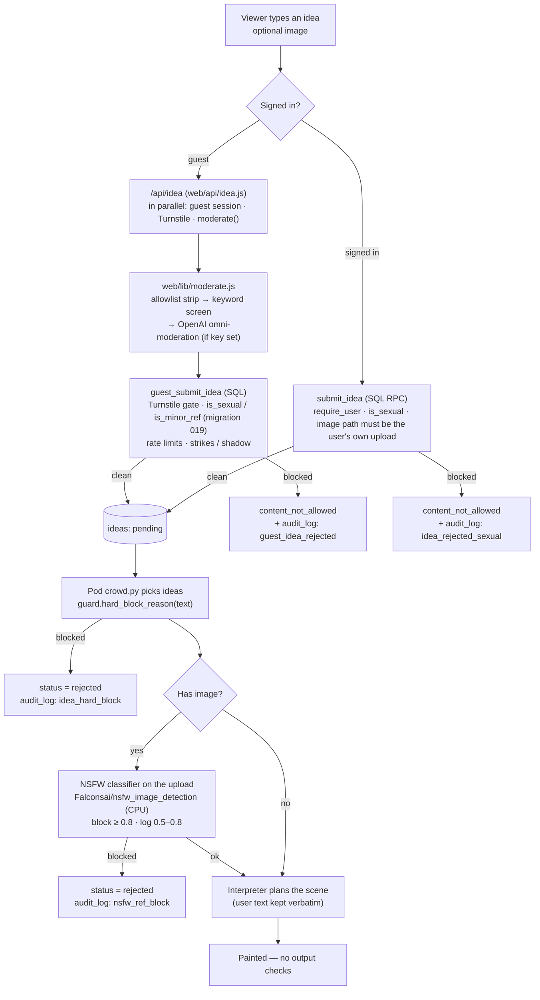

# Safety: how ideas and images are checked

Infinite Tapestry is "wild west, with hard lines". Gore, horror, violence, crude humour, satire and history (including dark history) are **allowed** and painted as written. A short list of hard lines is enforced at the *input*:

1. **Sexual content and nudity.** An allowlist of innocent phrases ("naked mole rat", "chicken breast", "blue tit", "comic strip", "kid goats", "Sussex"…) is removed *before* matching, so these never trip it.
2. **Minors combined with sexual content.** This is the strictest rule. A minor mentioned *without* sexual content is fine ("kids' crayon drawing of a castle").
3. **Hateful slurs.** Only the slurs themselves. Historical figures and symbols are allowed.

There are **zero checks on the live canvas output**. Nothing classifies or blurs the generated strips. Safety comes from what is allowed *into* the prompt, plus a fixed negative prompt on every strip ("nsfw, nude, naked, nudity, sexual, nipples, cleavage, erotic", `config.negative_prompt` / `prompts.py`). The negative prompt steers generation and blocks nothing.

## Step by step

### 1. Client (`frontend/src/legacy/social.js`)
The browser does **no** moderation. It sends the text, shows the server's verdict, and maps error codes to friendly messages. For example, `content_not_allowed` shows "That one's outside what the tapestry paints." Image ideas upload to the `idea-refs` storage bucket under the user's own folder first.

### 2. Guests: `/api/idea` → `web/lib/moderate.js`
`web/api/idea.js` trims the text to 300 characters and then runs three independent checks in parallel: the guest session (banned sessions get `not_allowed`), the **Cloudflare Turnstile** token if one was sent, and `moderate(text)`:

- **Allowlist first.** `ALLOW` removes the innocent phrases listed above.
- **Keyword screen.** It runs on the raw text and on a de-obfuscated copy (`n4k3d` → `naked`, `s.e.x` → `sex`):
  - sexual + minor → `minor_sexual`
  - sexual → `sexual`
  - slur → `hate`
  - a minor alone never blocks.
- **OpenAI omni-moderation.** This runs only when a server key is configured. It uses category *scores*, not the over-eager booleans: `sexual/minors` ≥ 0.5 → `minor_sexual`, and `sexual` ≥ 0.7 → `sexual`. Violence, gore and self-harm categories are deliberately ignored. A timeout (3.5 s) or error **fails open**, leaving the keyword screen and the later checks in place.

The verdict goes to the database as `p_flagged`.

### 3. Database rules (`guest_submit_idea`, `submit_idea`; matching functions in migration 019)
Migration 019 redefines `public.is_sexual` and `public.is_minor_ref` with the **same allowlist** (`public.mod_allow`), so the server and database agree.

- **Guests** (`guest_submit_idea`):
  - Turnstile is required when `idea_limits.turnstile_required` is on. A guest who passes once is remembered (`human_ok`).
  - Text is re-checked with `is_sexual` / `is_minor_ref` on top of the API verdict.
  - A block adds a **strike**. `minor_sexual` adds 99, which means instant shadow-mute. Repeat offenders are **shadow-muted**: their submissions look accepted to them but never play.
  - **Rate limits:** per guest and per IP per 10 minutes, plus caps on pending ideas, all admin-tunable in `idea_limits`. A brake tightens them when the queue is long. Errors: `rate_limited`, `too_many_pending`, `human_check`.
- **Signed-in users** (`submit_idea`, called directly via RPC):
  - Muted users are refused (`require_user`).
  - `is_sexual` blocks with `content_not_allowed`.
  - An attached image must be an existing object in the user's own `idea-refs/<uid>/` folder.

### 4. Pod: `infinite_tapestry/guard.py` (every picked idea)
When `crowd.py` picks pending ideas, each body goes through `guard.hard_block_reason`. It applies the same allowlist and a stricter sexual list, plus minors + sexual and slurs, and returns `"sexual"`, `"slur"` or nothing. A blocked idea is marked `rejected` and is never painted. Auto's own text is held to the same line: `interpreter.fallback_plan` replaces any disallowed raw text, story scenes are filtered with `is_disallowed`, and the bridge prompts in `transitions.py` are filtered too.

### 5. Uploaded images: NSFW classifier (`crowd._load_ref`, `nsfw.py`)
Image ideas are fetched (≤ 2 MB), downscaled to 768 px and scored by **`Falconsai/nsfw_image_detection`**, an open-source ViT running on CPU and loaded on first use:

- score ≥ **0.8** (`nsfw_threshold`): the idea is rejected.
- score in [**0.5**, 0.8) (`nsfw_log_min`): it is allowed, but logged as a near miss.
- an unreadable image is rejected.

A passing image steers the scene through IP-Adapter. It is never pasted into the canvas.

### 6. Chat uses the same screen
`/api/chat` runs `moderate()` and then `user_send_chat` adds `is_sexual` / `is_hateful`, a 200-character limit, no links and slow mode.

## What happens on a block

| Where | User sees | Logged |
|---|---|---|
| Guest idea (API/DB) | "That one's outside what the tapestry paints." (shadow-muted guests see a normal success) | `audit_log` → `guest_idea_rejected` (reason, first 120 chars) |
| Signed-in idea (DB) | same message | `audit_log` → `idea_rejected_sexual` |
| Picked idea (pod) | the idea simply doesn't play | `audit_log` → `idea_hard_block` (reason) |
| Uploaded image (pod) | the idea doesn't play | `audit_log` → `nsfw_ref_block`; near misses → `ops_events` `nsfw_near` (score, threshold) |
| Rate / human checks | "slow down" / human check prompts | (HTTP 429 / `human_check`) |

`audit_log` is append-only: a trigger refuses updates and deletes. Admins review blocks and sanctions (mute, ban, shadow) in the admin panel.
