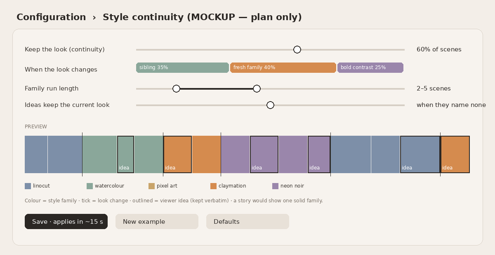

# Plan: style continuity for Auto (for review, not built)

**Goal.** Make Auto feel more coherent by often letting neighbouring scenes share a look, while keeping the occasional abrupt, delightful style jump. This should be a dial the admin can see and tune live, like scene widths.

## Concepts

- **Style family.** A small named group of related looks. For example *print* (linocut, risograph, woodblock, screen print), *paint* (watercolour, gouache, oil impasto), *toy* (claymation, tin toy diorama, knitted wool, papercraft), *screen* (pixel art, low-poly 3D, 1980s airbrush), *ink* (comic book ink, chalk, blueprint), *photo* (cinematic film still, golden-hour photograph). These are built from `variety.LOOKS` and grow as LOOKS grows.
- **Look.** One member of a family. The current look is carried in Auto's state, just as journeys already carry premise and style.

## Settings (stored in `auto_config.render.style`, read every 15 s like widths)

| Setting | Meaning | Default proposal |
|---|---|---|
| `keep` (0–100 %) | Chance the next Auto scene **keeps the current look** exactly | 50 % |
| `drift` mix (sums to 100) | When the look changes: **sibling** (another look in the same family), **fresh family** (a new family chosen with recent-history awareness), **bold contrast** (a family deliberately far from the current one) | 40 / 40 / 20 |
| `run` (min–max scenes) | How long a family stays before a change to a new family becomes possible | 2–5 |
| `ideas_follow` (on/off) | A viewer idea that names no look is painted in the current look (style supplied by the director, see below) | on |

The flow per Auto pick: if the run is not used up and a roll beats `keep`, then *same look*. Otherwise roll the drift mix. Every choice is stated to the planner **positively**, as "Paint this scene as {look}" or "Continue in the {family} family, this time as {sibling look}", never as a list of looks to avoid.

## Interactions

- **Stories:** unchanged. A story has ONE look (`stories.style`), and continuity settings are ignored while a story plays. After a story ends, the run starts fresh from the story's look, so the hand-off feels intentional.
- **Journeys:** a journey keeps its single look for its whole length (as today). The continuity dial governs only the moves *between* journeys and single free picks.
- **Viewer ideas stay verbatim:** the idea's text is never rewritten. With `ideas_follow` on and no look named in the idea, the look travels as the style LoRA / style channel the director already has (`make_scene(..., style=...)`), not as words added to the prompt. If an idea names a look, that look wins, and the run counter resets so Auto continues gracefully from it.
- **Variety sparks:** the spark (era, place, subject) still rotates every pick, so content keeps moving even when the look holds. Continuity applies to *look*, not to subject matter.
- **Width settings:** independent. The preview shows both, so the admin can see, for example, "long scenes plus long families" making a calm hour.

## Visual editor (Configuration tab)

- One slider for **Keep the look**.
- A three-segment **drift mix** bar with two draggable dividers.
- A dual-range slider for **Family run length**.
- A toggle for **Ideas follow the current look**.
- **Live schematic ribbon** reusing the width preview: each scene is a segment coloured by family (shades within a family = sibling looks), outlined segments are viewer ideas, and a tick marks every look change. *New example* re-rolls the example and *Defaults* resets.
- Save goes to `auto_config.render.style`, and the pod picks it up within ~15 s with no restart.

## Build sketch (≈ half a day)

1. `variety.py`: `FAMILIES = {name: [looks…]}` and `next_look(state, settings, rng, recent)` returning `(look, reason)`. Pure and unit-tested with seeded RNG, checking that the run lengths and mix ratios hold statistically.
2. `autopilot.py`: keep `look_state = {family, look, run}`. Pass the chosen look into `autoplan(..., keep_style=look)`, which already forces a single style.
3. `server.apply_render_settings`: clamp and apply `style` settings.
4. Admin: a new card in Configuration, preview drawn with the same SVG helper as the width ribbon.
5. Observability: log `look_reason` to `auto_decisions` so the morning check can confirm the mix.

## Open questions for review

- Should bold contrast ever fire *inside* the minimum run? (Proposal: never.)
- Should time of day bias families, e.g. *photo* at golden hour? This could be a later toggle.
